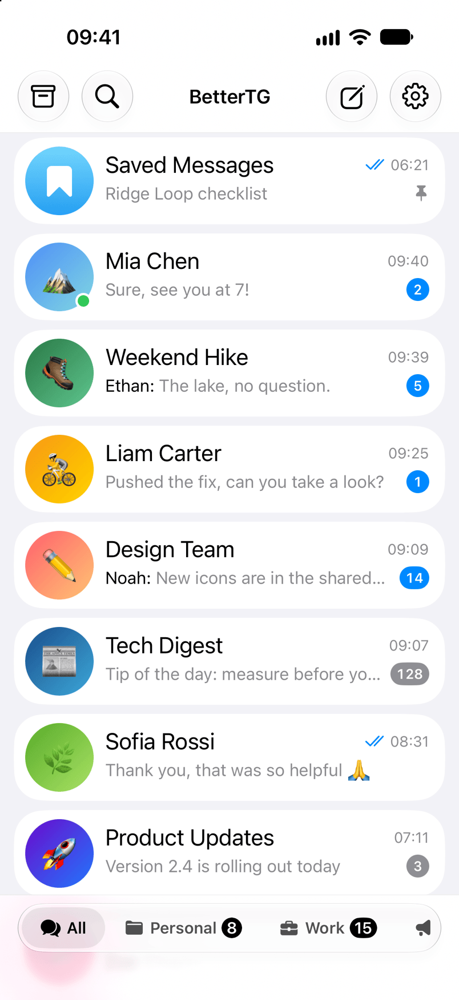
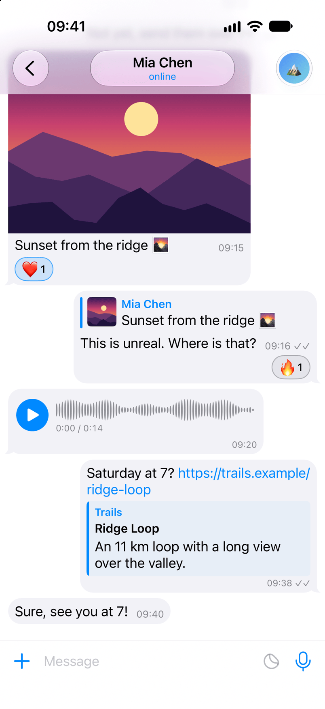
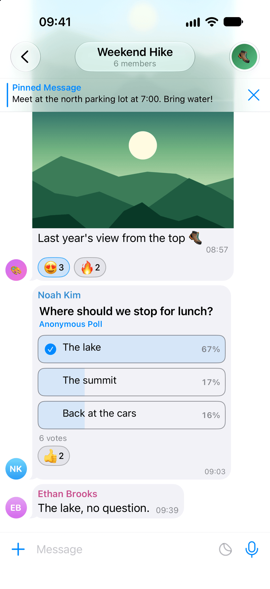
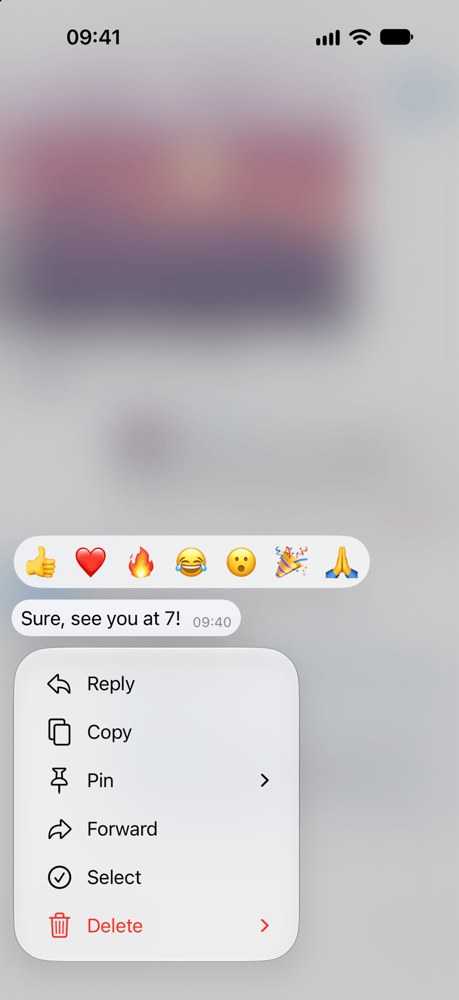
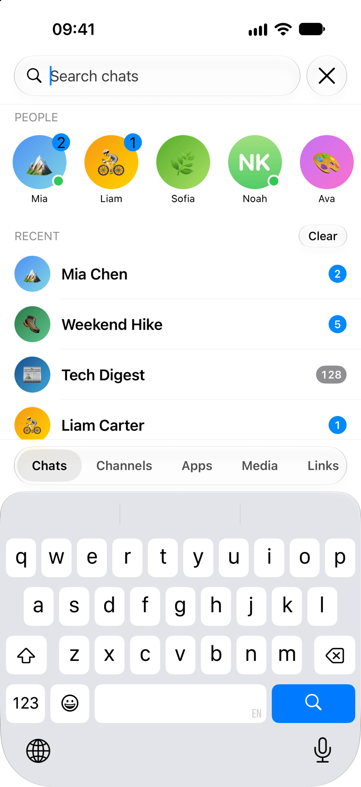
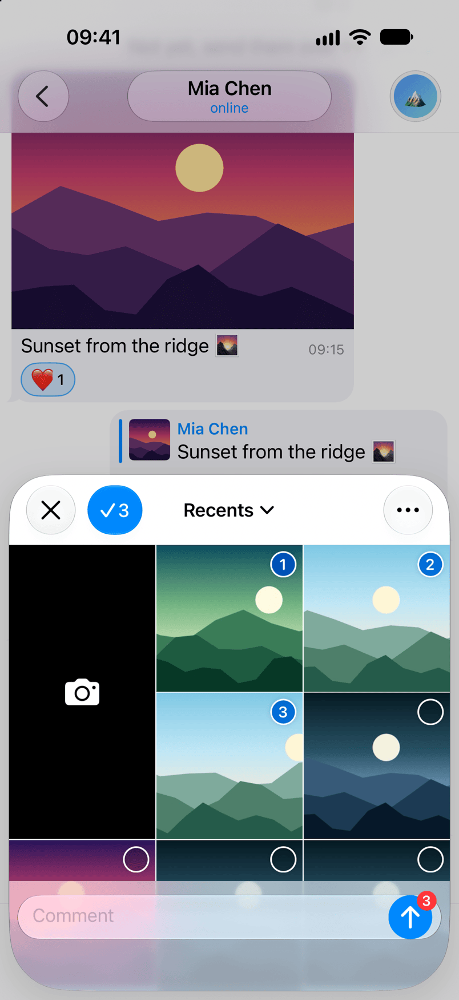
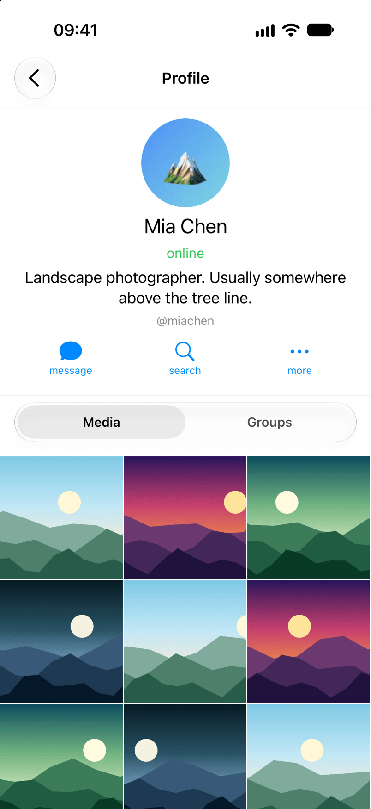
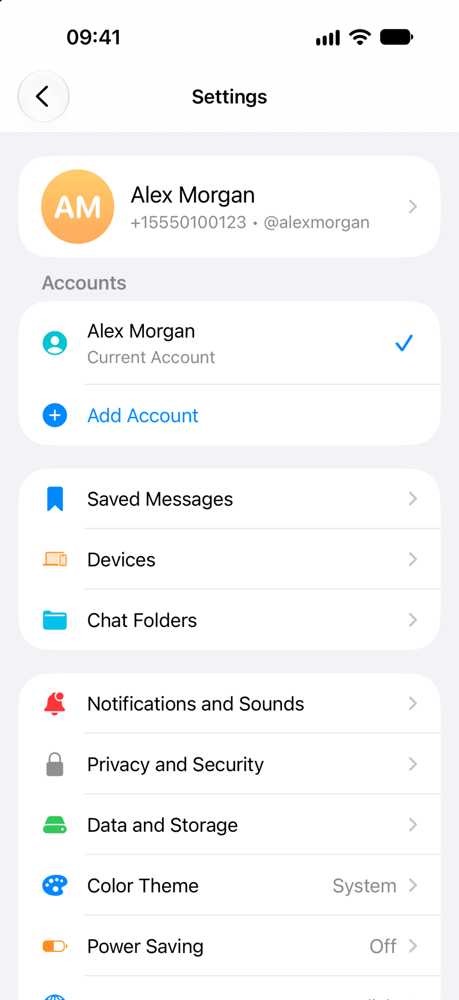
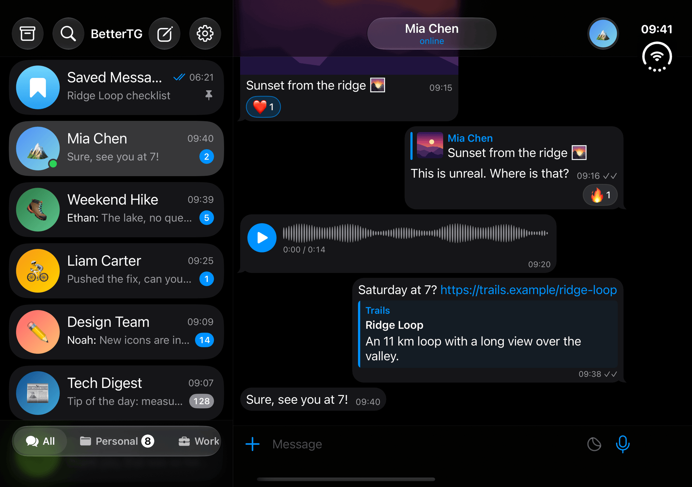

<div align="center">
  
</div>

# BetterTG

BetterTG is an open-source Telegram client for iPhone. It is written natively in UIKit on top of [TDLib](https://github.com/tdlib/td), follows the official Telegram app's behaviour and keeps a look of its own.

BetterTG was created by [Lev Poznyakov](https://github.com/levochkaa). It is in development; 0.1.0 is the first version.

Website: [bettertg.su](https://bettertg.su)

## Screenshots

<p align="center">
  <picture>
    <source media="(prefers-color-scheme: dark)" srcset="docs/screenshots/chats-dark.png">
    
  </picture>
  <picture>
    <source media="(prefers-color-scheme: dark)" srcset="docs/screenshots/chat-dark.png">
    
  </picture>
  <picture>
    <source media="(prefers-color-scheme: dark)" srcset="docs/screenshots/group-dark.png">
    
  </picture>
  <picture>
    <source media="(prefers-color-scheme: dark)" srcset="docs/screenshots/menu-dark.png">
    
  </picture>
</p>

<p align="center">
  <picture>
    <source media="(prefers-color-scheme: dark)" srcset="docs/screenshots/search-dark.png">
    
  </picture>
  <picture>
    <source media="(prefers-color-scheme: dark)" srcset="docs/screenshots/attach-gallery-dark.png">
    
  </picture>
  <picture>
    <source media="(prefers-color-scheme: dark)" srcset="docs/screenshots/profile-dark.png">
    
  </picture>
  <picture>
    <source media="(prefers-color-scheme: dark)" srcset="docs/screenshots/settings-dark.png">
    
  </picture>
</p>

On iPhone Duo, the list and the chat sit side by side while it is unfolded:

<p align="center">
  
</p>

The people and chats in these screenshots are made up. [docs/screenshots](docs/screenshots) has more of them, such as the channel, the archive and the rest of the attachment sheet.

## Features

- A chat list with folders, the archive, pinned chats and search across chats, messages and public channels.
- Messages with formatting, replies, edits, forwards, reactions, polls, locations and contacts.
- Photos, videos, albums, files, GIFs, stickers, and custom and animated emoji.
- Voice and video messages, recorded and played in the chat.
- Groups with forum topics, channels with comments, stories, bots with keyboards, inline bots and mini apps.
- Profiles and Telegram's settings: privacy, notifications, data and storage, devices, passcode and proxy.
- Several accounts on one device.
- iPhone Duo in every posture, with the list and the chat in two columns while it is unfolded.
- Rich notifications with avatars, media and quick replies, through the [push relay](#push-notifications).

## Repository

| Path | Contents |
| --- | --- |
| `BetterTG` | The app: UIKit screens, TDLib services and media playback |
| `BetterTGNotificationService` | The notification service extension behind rich notifications |
| `Packages/FFmpegBridge` | FFmpeg for video, GIF and voice message playback and voice encoding |
| `Packages/RLottie` | Telegram's rlottie fork for animated stickers and emoji |
| `Backend` | The Rust push relay ([README](Backend/README.md)) |
| `Website` | [bettertg.su](https://bettertg.su), with the privacy policy and terms |
| `Configuration` | Signing identity and push relay settings |
| `script`, `fastlane` | Build, setup and release tooling |
| `docs` | Notes on individual features and on releasing |

## Building

You need a Mac with Xcode 27.2 at `/Applications/Xcode-27.2.0.app` (pass `--xcode PATH` for another location), [XcodeGen](https://github.com/yonaskolb/XcodeGen), [SwiftFormat](https://github.com/nicklockwood/SwiftFormat) and jq (`brew install xcodegen swiftformat jq`), and a Telegram `api_id` and `api_hash` from [my.telegram.org](https://my.telegram.org) → API development tools.

```bash
./setup.sh               # asks for the api_id and api_hash
./build.sh build         # build for the Simulator
./build.sh run           # build and launch in the Simulator
./build.sh run --device  # build and launch on a connected iPhone
```

A device build needs your own team and bundle ID: `./setup.sh --team TEAMID --bundle-id com.example.BetterTG`. `./setup.sh --help` and `./build.sh --help` list every option. [docs/releasing.md](docs/releasing.md) covers TestFlight and App Store builds.

## Push notifications

Telegram delivers notifications to third-party apps only through Web Push, which an iPhone app can't receive on its own. BetterTG's relay in [Backend](Backend) receives them at `push.bettertg.su`, decrypts each one to show the sender and a preview, and hands it to Apple's push service. It doesn't sign in to Telegram, and it keeps a decrypted notification for 15 minutes at most. The [Privacy Policy](https://bettertg.su/privacy) lists everything the relay stores.

Turning off Notifications via BetterTG Server in Settings → Notifications and Sounds deletes the device's data from the relay; BetterTG then notifies only while it is open. A fork signed with its own bundle ID can't use the official relay: [Backend/SELF-HOSTING.md](Backend/SELF-HOSTING.md) explains how to run one, or `./setup.sh --no-relay` builds without it.

## Contributing

Contributions are welcome. [CONTRIBUTING.md](CONTRIBUTING.md) covers setup, conventions and pull requests.

## License

BetterTG is released under the [GNU General Public License v3.0](LICENSE). You may use, change and share it, commercially too, as long as what you distribute stays under the same license and comes with its source code.

Copyright © 2022–2026 Lev Poznyakov and the BetterTG contributors. BetterTG ports code and assets from [Telegram for iOS](https://github.com/TelegramMessenger/Telegram-iOS), licensed under GPL-2.0-or-later, and includes the open-source components listed in Settings → Licenses, whose texts are in [BetterTG/Resources/Licenses](BetterTG/Resources/Licenses).

BetterTG is an independent project. It is not affiliated with, endorsed by or sponsored by Telegram. Telegram is a trademark of its owner.
